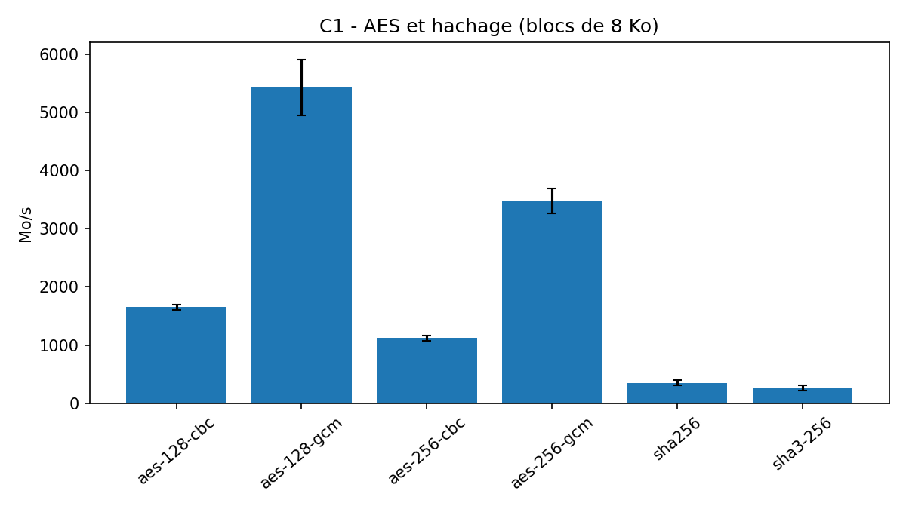
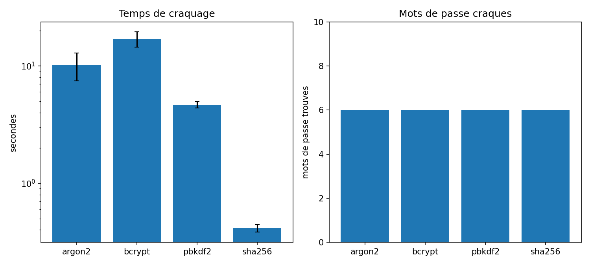
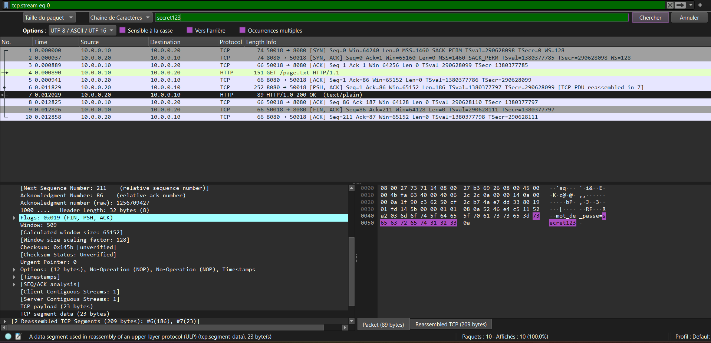
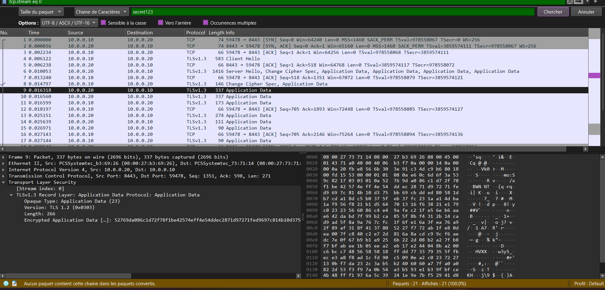

# secureai-gateway

**Évaluation comparative de solutions de sécurité** : algorithmes cryptographiques, hachage de
mots de passe, protocoles de protection du trafic réseau, IDS et pare-feu.

Mini-projet réalisé à deux : **Nessryne Chouchene** (partie A) et **Oumayma Hamdy** (partie B).
Le projet ne se contente pas d'utiliser des outils de sécurité déjà prêts : nous les avons
**configurés, attaqués, mesurés et comparés**, puis nous recommandons un choix argumenté selon le besoin.

> **Rapport complet : [`docs/rapport_final.pdf`](docs/rapport_final.pdf)** (source LaTeX : [`docs/latex/rapport_final.tex`](docs/latex/rapport_final.tex))

## Problématique

Quelles solutions de sécurité faut-il choisir pour protéger une communication réseau, en fonction
de la sécurité apportée, des performances et de la complexité de configuration ?

| | Comparaison | Solutions étudiées | Auteur |
|---|---|---|---|
| **C1** | Algorithmes cryptographiques | AES (CBC, GCM), SHA-256, SHA3-256, RSA, ECDSA, Ed25519 | A |
| **C2** | Hachage de mots de passe | SHA-256 simple, PBKDF2, bcrypt, Argon2id, craquage avec John the Ripper | A |
| **C3** | Protocoles de protection du trafic | TLS (stunnel), WireGuard, tunnel SSH, trafic en clair | B |
| **C4** | IDS et pare-feu | Suricata (règles Emerging Threats et règles locales), nftables | B |

## Résultats principaux

| Sujet | Résultat mesuré |
|---|---|
| AES-GCM contre AES-CBC | GCM environ **3,3 fois plus rapide** (5 432 contre 1 652 Mo/s en AES-128) |
| Signatures | ECDSA P-256 : 48 967 signatures/s contre 1 423 pour RSA-2048, soit environ **34 fois plus vite** |
| Mots de passe | SHA-256 simple craqué en 0,41 s ; bcrypt en 17,0 s (environ **40 fois plus long**, avec des coûts volontairement faibles) |
| Protocoles (débit, 100 Mo) | TLS −25 %, tunnel SSH −35 %, WireGuard −89 % par rapport au clair (CPU du serveur saturé à environ 89 % sur WireGuard) |
| Confidentialité (Wireshark) | `secret123` lisible en clair ; **introuvable** avec TLS, WireGuard et SSH |
| IDS | Suricata détecte le ping, le scan de ports et le brute force SSH, sans faux positif sur le trafic normal |
| Pare-feu | nftables avec politique de refus par défaut et limite de débit : **162 paquets** rejetés pendant l'attaque simulée |

Les mesures absolues varient d'une session à l'autre en machine virtuelle : les comparaisons ne
sont valables qu'au sein d'une même session (voir la section « Limites » du rapport).

<p>


</p>
<p>


</p>

## Contenu du dépôt

```
algorithms/     C1 : bench_c1.py (openssl speed), plot_c1.py, bench_utils.py
passwords/      C2 : gen_data.py, bench_c2.py, crack_c2.sh (John the Ripper), plot_c2.py, data/
config/         Configurations de la partie B : stunnel, WireGuard (sans clés privées),
                nftables, règles locales Suricata, suricata.yaml
results/        Résultats bruts : CSV, journaux Suricata, captures réseau (.pcap), graphiques
docs/           Rapport final (PDF + source LaTeX) et captures d'écran (docs/captures/)
vagrant/        Vagrantfile et provisionnement pour recréer le laboratoire
run_all_A.sh    Relance toute la partie A d'un seul coup
requirements.txt  Dépendances Python (bcrypt, argon2-cffi, pandas, matplotlib)
```

## Laboratoire

Deux machines virtuelles sur un **réseau interne isolé** (VirtualBox), sans accès extérieur pendant
les mesures et les attaques :

| VM | Rôle | IP |
|---|---|---|
| client | Client et attaquant (Nmap, Hydra, iperf3, curl, Wireshark) | 10.0.0.10 |
| serveur | Serveur et défense (SSH, web, TLS, WireGuard, Suricata, nftables) | 10.0.0.20 |

- Les mesures de la partie B ont été faites sur deux VM Lubuntu 24.04 (2 vCPU, 2 Go de RAM), configurées avec les fichiers de `config/`.
- Pour la partie A, le laboratoire peut être recréé avec Vagrant (Ubuntu 22.04 et bureau Lubuntu) :

```bash
cd vagrant
vagrant up client            # partie A : une seule VM suffit
vagrant ssh client           # puis, dans la VM : cd ~/project
```

## Reproduire la partie A (C1 et C2)

Dans la VM client, depuis la racine du dépôt :

```bash
sudo apt install -y python3-pip openssl
sudo snap install john-the-ripper     # John « jumbo » requis (le paquet apt 1.8.0 manque de formats)
bash run_all_A.sh                     # C1 + C2 + craquage + graphiques -> results/
```

Les fichiers produits sont `results/c1_*.csv|png` et `results/c2_*.csv|png`. Chaque mesure est répétée
5 fois ; les tableaux du rapport donnent les moyennes.

## Mettre en place la partie B (C3 et C4)

Les mesures ont été faites avec `iperf3`, `curl`, `ping` et Wireshark ; les fichiers utiles sont dans `config/` :

| Fichier | Usage |
|---|---|
| `config/stunnel.conf` | Point d'entrée TLS 1.3 devant le serveur web |
| `config/wg0_client.conf`, `config/wg0_serveur.conf` | Tunnel WireGuard (les clés privées ne sont **pas** versionnées) |
| `config/local_j6.rules`, `config/suricata_j5.yaml` | Règles locales et configuration de Suricata |
| `config/nftables_j6.conf` | Pare-feu nftables (refus par défaut, SSH limité) |

Contrôles utiles : `suricata -T -c /etc/suricata/suricata.yaml` (validation de la configuration),
`nmap -sS -sV -p 1-2000 10.0.0.20` (scan testé), `sudo nft list ruleset` (règles actives).
Un tunnel SSH par redirection de port (`ssh -L`) remplace IPsec, prévu à l'origine, pour tenir les délais.

## Résultats bruts

Les fichiers de `results/` portent un numéro de session de mesure. **Les tableaux comparatifs du
rapport utilisent la session 4** (`*4_*.csv`) : `debit4_*` (débit), `req4_*` (petite requête),
`tls4_handshake`, `wg4_ping`. Les journaux d'alertes Suricata sont `fast_j5.log` et `fast_j6.log` ;
les captures réseau sont les `*.pcap`.

## Éthique et sécurité

Toutes les attaques (scan, brute force) ont été menées **uniquement dans le réseau virtuel isolé** du
projet, sur des machines et des comptes créés pour l'occasion. Les clés privées ne sont pas versionnées.

## Équipe

- **A : Nessryne Chouchene** : C1 (algorithmes) et C2 (mots de passe)
- **B : Oumayma Hamdy** : C3 (protocoles) et C4 (IDS et pare-feu)
